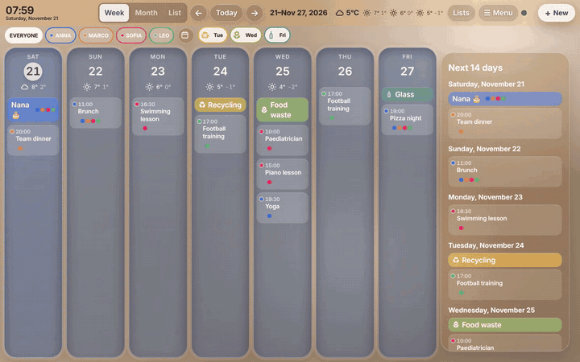
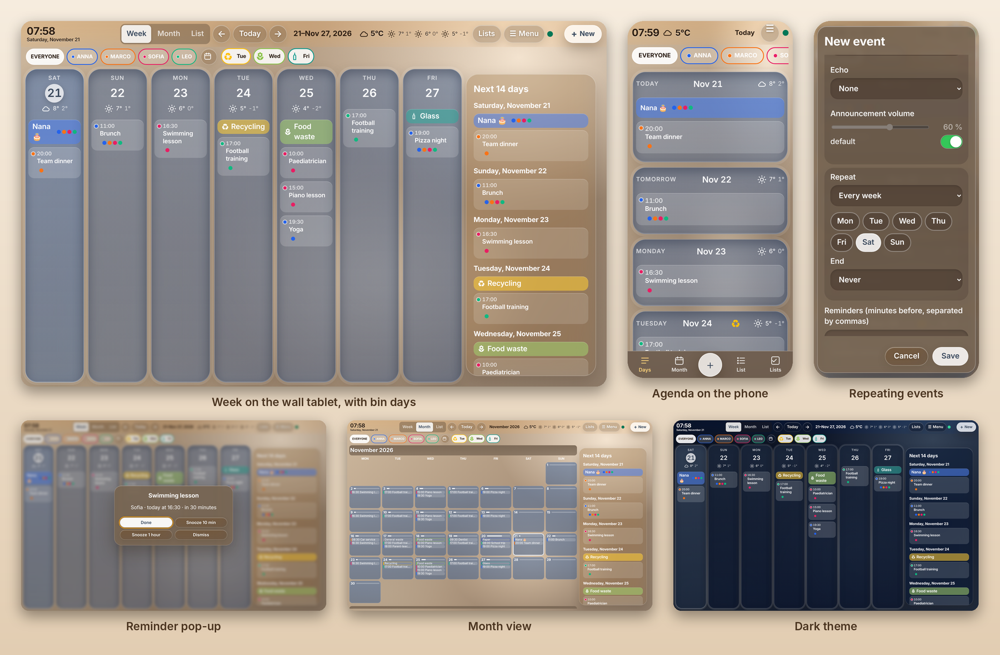

<p align="center">
  
</p>

<h1 align="center">Family Hub</h1>

<p align="center">
  <a href="https://github.com/EdisonACDC/family-hub/releases"></a>
  <a href="https://analytics.home-assistant.io/custom_integrations.json"></a>
  <br>
  <sub>Die Downloads enthalten auch Updates; die aktiven Installationen stammen aus Home Assistant Analytics (nur wer die Statistik eingeschaltet hat).</sub>
</p>

<p align="center">
  <a href="README.md">English</a> · <a href="README.it.md">Italiano</a> · <b>Deutsch</b>
</p>

<p align="center">
  Der Familienkalender, den Home Assistant gefehlt hat: eine Farbe pro Person, Erinnerungen auf dem
  Handy, bei Alexa und auf dem Wand-Tablet, Mülltermine und Schulferien – in wenigen Minuten
  eingerichtet, ohne YAML.
</p>

<p align="center">
  <a href="https://github.com/EdisonACDC/family-hub/releases/latest"></a>
  <a href="https://hacs.xyz/"></a>
  <a href="https://ko-fi.com/edisonacdc"></a>
</p>

<p align="center">
  <a href="https://my.home-assistant.io/redirect/hacs_repository/?owner=EdisonACDC&repository=family-hub&category=integration"></a>
  &nbsp;
  <a href="https://my.home-assistant.io/redirect/supervisor_add_addon_repository/?repository_url=https%3A%2F%2Fgithub.com%2FEdisonACDC%2Ffamily-hub"></a>
</p>

<p align="center">
  
</p>

<p align="center">
  
</p>

## Funktionen

- **Wochenansicht** auf dem Wand-Tablet und am PC, und eine **Agenda** auf dem Handy (heute und morgen).
- **Eine Farbe pro Person**, ganztägige und terminierte Ereignisse, Filter pro Kalender, und die Schaltfläche **+** für neue Termine.
- **Wiederkehrende Termine**: täglich, wöchentlich an gewählten Tagen, alle 2 Wochen, monatlich, jährlich. Sie enden nie, an einem Datum oder nach einer Anzahl. Beim Bearbeiten oder Löschen wird gefragt: *nur dieser*, *dieser und die folgenden* oder *alle*.
- **Erinnerungen**: Hinweise auf dem Tablet (*Erledigt*, *Verschieben*, *Stopp*), Handy-Benachrichtigungen mit Schaltflächen, Alexa oder Sprachausgabe, und Zusammenfassungen am Morgen und am Abend.
- **Mülltermine**: eine Erinnerung pro Abholung, am Abend vorher und am Morgen. Die Arten werden am Titel erkannt (Restmüll, Bio, Papier, Gelber Sack, Glas), die Farben lassen sich ändern. Abholungen können auch von Hand eingetragen werden: wöchentlich, alle 2 oder 4 Wochen oder monatlich, mit zusätzlichen und übersprungenen Daten.
- **Wetter** aus der Entität deiner Wahl: oben, unter jedem Tag und in den Zusammenfassungen.
- **Schichten** pro Person, über mehrere Tage eingetragen.
- **Einkaufslisten** aus den To-do-Listen von Home Assistant.
- **Rollen**: Erwachsene sehen alles, Kinder sehen ihre eigenen Termine und Erinnerungen, Gäste können nur lesen.
- **Externe Kalender** (ICS): Schulferien, Feiertage, Müllkalender der Gemeinde. Nur lesen.

## Installation

1. **Integration installieren.** Öffne in HACS **⋮ → Benutzerdefinierte Repositories**, füge `https://github.com/EdisonACDC/family-hub` als **Integration** hinzu, installiere **Family Hub** und starte Home Assistant neu. Füge sie unter **Einstellungen → Geräte & Dienste → Integration hinzufügen** hinzu.
2. **Add-on installieren.** Nutze die Schaltfläche oben oder gehe zu **Einstellungen → Add-ons → Add-on-Store → ⋮ → Repositories** und füge `https://github.com/EdisonACDC/family-hub` ein. Öffne **Family Hub UI**, drücke **Installieren** und dann **Starten**.
3. **Family Hub öffnen** aus dem Seitenmenü. Die Einrichtungshilfe öffnet sich beim ersten Mal von selbst: Gib der Familie einen Namen, füge die Personen hinzu, wähle die Kalender – fertig.

Das Add-on setzt voraus, dass die Integration schon eingerichtet ist.

> **Achtung beim Namen im Marketplace.** Bei der Suche nach „Family Hub“ erscheint auch **Family Hub Card** eines anderen Autors: das ist nicht dieses Projekt. Wähle **Family Hub** vom Typ **Integration**, Autor **EdisonACDC**.

## Konfiguration

In der Einrichtungshilfe, oder später unter **Einstellungen → Geräte & Dienste → Family Hub → Konfigurieren**:

- **Familie**: Name, Sprache, erster Tag der Woche, 24-h- oder 12-h-Uhr.
- **Personen**: Name, Farbe, Rolle (Erwachsener, Kind, Gast), verknüpfter Home-Assistant-Benutzer, Handy und Lautsprecher für Hinweise, Ruhezeiten.
- **Kalender**: Kategorien wie Familie, Schule, Arzt, Geburtstage oder eigene.
- **Erinnerungen**: Vorlauf, Kanäle, Familienruhe, Zeiten der Zusammenfassung.
- **Quellen**: To-do-Listen, bereits in Home Assistant vorhandene Kalender, eine Wetter-Entität (`weather.*`).
- **Externe Kalender** (nur Erwachsene): eine ICS-Datei per Link oder Datei. Aktualisierung alle 12 Stunden.
- **Hinweise**: pro Person, Handy und Echo, aus denen Home Assistant bekannt sind, Kanäle, Lautstärke der Ansage, Ruhezeit und ein Test.

## Einladungen für die Großeltern

Ab Family Hub 0.9 können Menschen **ohne Home-Assistant-Konto** (zum Beispiel die Großeltern) Family Hub als App auf dem Telefon haben, nur die Termine sehen, die du auswählst, eigene eintragen und Mitteilungen bekommen.

1. Als Erwachsener **☰ → Teilen → Einladungen** öffnen und eine Einladung erstellen: Name („Oma“), sichtbare Personen und Kalender (zum Beispiel Sofia: Schule, Kita, Arzt), Rechte („Nur ansehen“, „Ansehen und eintragen“, „Ansehen, eintragen und eigene ändern“), wohin eingetragene Termine gehen („Erst bestätigen“, voreingestellt, oder „Sofort im Kalender“), Mitteilungen ja oder nein, Ablauf einer unbenutzten Einladung (7 Tage).
2. Den Link mit **Kopieren**, **Teilen** oder per **QR-Code** weitergeben. Der Link ist nur in diesem Moment zu sehen und **persönlich und einmalig**: er gilt für ein einziges Telefon.
3. Das Telefon öffnet den Link: Android/Chrome bietet **App installieren** an; auf dem iPhone (iOS 16.4+) mit **Safari** oder **Chrome**: **Teilen** (in Safari unten, in Chrome in der Adressleiste) **→ Zum Home-Bildschirm**; die Einladung wird beim Öffnen des Symbols auf dem Home-Bildschirm benutzt (im Browser nie). Öffnet sich das Symbol mit „Eine Einladung wird gebraucht“, auf **Einladungslink einfügen** tippen.
4. Das Telefon **wartet**, bis ein Erwachsener es bestätigt: Home Assistant und die Telefone der Erwachsenen bekommen eine Mitteilung mit **Bestätigen / Ablehnen**, und das Telefon erscheint unter **Teilen → Geräte**.
5. Unter **Geräte** kann man ein Telefon umbenennen, seine Rechte ändern oder es **Ausschalten** – sofort. Bei einem Handywechsel erstellt **Neues Telefon** eine Einladung, die das alte ersetzt, mit denselben Einstellungen. Unter **Aktivitäten** stehen die letzten 200 Ereignisse.

Termine, die bestätigt werden müssen, zeigt Family Hub mit **„1 Termin wartet auf Bestätigung“** (Annehmen / Ändern / Ablehnen); angenommene tragen den Vermerk „eingetragen von Oma“.

**Eine externe Adresse ist nötig.** Die Web-App kommt von der Integration (nicht vom Add-on, weil Ingress eine Anmeldung verlangt) unter `/api/family_hub/guest/`. Damit sie unterwegs funktioniert, braucht Home Assistant eine **externe URL**: Home Assistant Cloud (Nabu Casa) oder eine eigene Domain mit HTTPS, einzustellen unter **Einstellungen → System → Netzwerk**. Ohne sie geht der Link nur im Heimnetz, und die Seite Teilen sagt das.

**Sicherheit.** Die Tokens der Einladungen und Telefone sind zufällig (256 Bit), werden nur als Prüfsumme (SHA-256) gespeichert und nie protokolliert; das Einladungs-Token steht hinter dem `#` des Links und erreicht daher nie die Server-Logs. Der Filter nach Personen und Kalendern läuft immer in Home Assistant: ein Gast bekommt nie andere Termine, andere Personen, Entitäten oder Einstellungen. Anfragen sind pro Telefon und pro Adresse begrenzt, eine Adresse wird nach 10 falschen Aktivierungen gesperrt, und das Telefon-Token wird alle 30 Tage erneuert. Wer keine Einladung erstellt, hat keine neue erreichbare Adresse.

**Mitteilungen auf dem Telefon der Großeltern.** Sie werden mit **🔔 Mitteilungen einschalten** in der App eingeschaltet (nie von selbst): Erinnerungen an die sichtbaren Termine (gleiche Minuten vorher und gleiche Ruhezeiten wie die Familie), Änderungen und Absagen, und das Ergebnis ihrer Anfragen. Das iPhone braucht **iOS 16.4 oder neuer**, mit der App über ihr Symbol auf dem Home-Bildschirm geöffnet (hinzugefügt aus Safari oder Chrome).

**In der Web-App.** Die Woche und die nächsten Tage in den Farben der Familie, **+ Hinzufügen** (wenn die Rechte es erlauben) und für jedes Telefon eigene Erinnerungen und Ruhezeiten (leer: die der Familie). Die Termine bleiben auch ohne Netz lesbar (eine Kopie auf dem Telefon, gelöscht, wenn der Zugang endet).

**Was jeder Gast nutzen darf (ab Family Hub 0.10).** Unter **Teilen**, in der neuen Einladung und in **Rechte ändern**, wählst du für jeden Gast eine Vorlage (**Großeltern**, **Babysitter**, **Verwandte**, **Eigene Auswahl**), den Modus (**Einfach**: große Schrift und wenige Punkte; **Vollständig**: dasselbe Family-Hub-Panel mit Woche, Monat, Liste, Personenfiltern, Müll und Wetter) und jede Funktion einzeln: Kalender, Termine hinzufügen und ändern, Schichten, Listen (welche, und ob hinzufügen und abhaken erlaubt ist), Erinnerungen, Benachrichtigungen, Mülltage, Wetter und die **externen Kalender** (Schule, Google, ICS), nur lesend. Standardmäßig ist nur der Kalender an, nur lesend. Home Assistant prüft jedes Recht: Eine ausgeschaltete Funktion antwortet nicht, und Gäste bekommen nie Teilen, den Assistenten, die Seite der externen Kalender oder Einstellungen. Einladungen und Telefone aus 0.9 funktionieren weiter und werden zu „Großeltern (Einfach)“ mit ihren bisherigen Rechten.

**Schichten der Großeltern.** Ist die Einladung für eine Person mit **„Hat eigene Arbeitsschichten“**, zeigt die Web-App **Meine Schichten**: eine Monatstafel wie in Family Hub (Schicht wählen, Tage antippen, **Speichern**) und einen Wechsel zum Wiederholen. Im Familienkalender heißen die Schichten „Oma · Früh“.

**Privatsphäre.** Ein Gast sieht nur die Personen aus seiner Einladung; Termine anderer erreichen ihn nie, weder in der App noch in Mitteilungen noch in der Kopie auf dem Telefon. Ein als **Privat** markierter Termin geht nie an Gäste, auch wenn er eine Person betrifft, die sie sehen.

## Häufige Fragen

**Brauche ich Alexa?** Nein. Lautsprecher sind optional; ohne sie funktionieren die anderen Kanäle.

**Brauche ich die Home-Assistant-App auf dem Handy?** Nein. Für Handy-Benachrichtigungen schon; ohne sie sind diese Optionen einfach ausgeblendet.

**Brauche ich YAML?** Nein. Alles wird in der Oberfläche eingerichtet.

**Brauche ich das Add-on?** Kalender und Erinnerungen funktionieren mit der Integration allein. Die Bildschirmansicht fürs Tablet ist das Add-on.

**Wo werden die Daten gespeichert?** Es gibt keine Datenbank. Die Einstellungen stehen in den Optionen der Integration, der Inhalt externer Kalender im Speicher von Home Assistant.

**In welchen Sprachen gibt es es?** Italienisch, Deutsch und Englisch, je nach Sprache von Home Assistant.

## Stand und Grenzen

- Getestet mit Home Assistant 2026.10.4 auf einer Testinstallation (automatische Tests) und auf einem Tablet im Browser. Noch zu prüfen in einem echten Zuhause: den Download eines externen Kalenders über einen Link, die Schaltflächen der Handy-Benachrichtigungen (Ereignis `mobile_app_notification_action` der Companion-App) und Alexa-Ansagen.
- Die Wetter- und Müll-Symbole wurden für dieses Projekt gezeichnet.
- Die Personen und Kalender in den Tests sind erfunden.

## Unterstützung

Wenn Family Hub deiner Familie hilft, kannst du mir einen Kaffee spendieren ☕ [ko-fi.com/edisonacdc](https://ko-fi.com/edisonacdc)

Wenn es deiner Familie hilft, gib dem Repository einen ⭐ – so finden andere Familien es.

## Entwicklung

Integration (aus dem Hauptordner, mit einer Test-Instanz von Home Assistant):

```bash
python -m venv .venv
. .venv/bin/activate
pip install -r requirements_test.txt
pytest
ruff check . && ruff format --check .
mypy
```

Add-on (mit einem Fake-Home-Assistant und dem Browser Microsoft Edge):

```bash
cd addon
pip install -r requirements.txt pytest playwright
pytest
```

## Lizenz

MIT, siehe [LICENSE](LICENSE). Changelog des Add-ons: [addon/CHANGELOG.md](addon/CHANGELOG.md).
