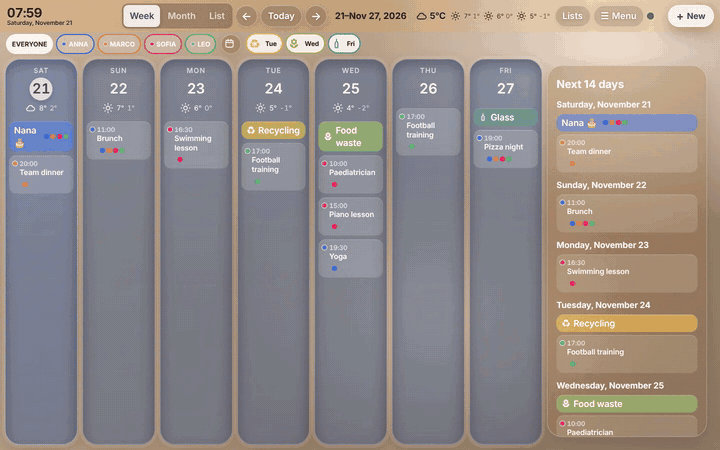
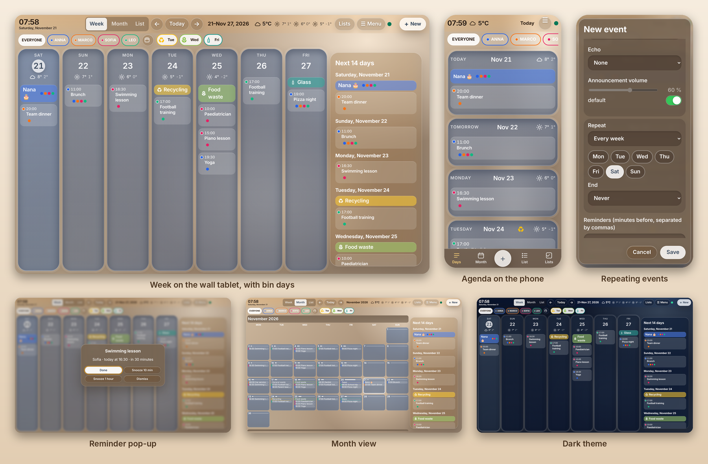

<p align="center">
  
</p>

<h1 align="center">Family Hub</h1>

<p align="center">
  <a href="README.md">English</a> · <b>Italiano</b> · <a href="README.de.md">Deutsch</a>
</p>

<p align="center">
  Il calendario di famiglia che Home Assistant non aveva: un colore per ogni persona, promemoria sul
  telefono, su Alexa e sul tablet da parete, giorni dei rifiuti e vacanze scolastiche – configurato in
  pochi minuti, senza YAML.
</p>

<p align="center">
  <a href="https://github.com/EdisonACDC/family-hub/releases/latest"></a>
  <a href="https://hacs.xyz/"></a>
  <a href="https://ko-fi.com/edisonacdc"></a>
</p>

<p align="center">
  <a href="https://my.home-assistant.io/redirect/hacs_repository/?owner=EdisonACDC&repository=family-hub&category=integration"></a>
  &nbsp;
  <a href="https://my.home-assistant.io/redirect/supervisor_add_addon_repository/?repository_url=https%3A%2F%2Fgithub.com%2FEdisonACDC%2Ffamily-hub"></a>
</p>

<p align="center">
  
</p>

<p align="center">
  
</p>

## Funzioni

- **Vista settimana** sul tablet da parete e sul PC, e **agenda** sul telefono (oggi e domani).
- **Un colore per persona**, eventi di tutto il giorno e a orario, filtri per calendario, e il pulsante **+** per un nuovo evento.
- **Appuntamenti che si ripetono**: ogni giorno, ogni settimana nei giorni scelti, ogni 2 settimane, ogni mese, ogni anno. Finiscono mai, a una data o dopo un numero di volte. Modifica ed eliminazione chiedono: *solo questo*, *questo e i successivi*, oppure *tutti*.
- **Promemoria**: avvisi sul tablet (*Fatto*, *Posticipa*, *Ferma*), notifiche sul telefono con pulsanti, altoparlanti Alexa o sintesi vocale, e riepiloghi del mattino e della sera.
- **Ritiri dei rifiuti**: un promemoria per ogni ritiro, la sera prima e la mattina. I tipi sono riconosciuti dal titolo (Restmüll, Bio, Papier, Gelber Sack, Glas) e i colori si possono cambiare. I ritiri si possono anche inserire a mano: ogni settimana, ogni 2 o 4 settimane, o ogni mese, con date extra e date saltate.
- **Meteo** dall'entità che scegli: in alto, sotto ogni giorno e nei riepiloghi.
- **Turni** per persona, inseriti su più giorni.
- **Liste** della spesa dai to-do di Home Assistant.
- **Ruoli**: l'adulto vede tutto, il bambino vede i propri eventi e avvisi, l'ospite può solo leggere.
- **Calendari esterni** (ICS): vacanze scolastiche, festività, rifiuti del comune. Sola lettura.

## Installazione

1. **Installa l'integrazione.** In HACS apri **⋮ → Repository personalizzati**, aggiungi `https://github.com/EdisonACDC/family-hub` come **Integrazione**, installa **Family Hub**, poi riavvia Home Assistant. Aggiungila da **Impostazioni → Dispositivi e servizi → Aggiungi integrazione**.
2. **Installa l'add-on.** Usa il pulsante qui sopra, oppure vai su **Impostazioni → Add-on → Add-on Store → ⋮ → Repository** e incolla `https://github.com/EdisonACDC/family-hub`. Apri **Family Hub UI**, premi **Installa**, poi **Avvia**.
3. **Apri Family Hub** dal menu laterale. La procedura guidata si apre da sola la prima volta: dai un nome alla famiglia, aggiungi le persone, scegli i calendari, e hai finito.

L'add-on richiede che l'integrazione sia già configurata.

> **Attenzione al nome nel Marketplace.** Cercando «Family Hub» compare anche **Family Hub Card**, di un altro autore: non è questo progetto. Scegli **Family Hub** di tipo **Integrazione**, autore **EdisonACDC**.

## Configurazione

Dalla procedura guidata, o più tardi da **Impostazioni → Dispositivi e servizi → Family Hub → Configura**:

- **Famiglia**: nome, lingua, primo giorno della settimana, orario 24 h o 12 h.
- **Persone**: nome, colore, ruolo (adulto, bambino, ospite), utente Home Assistant collegato, telefono e altoparlante per gli avvisi, orari di silenzio.
- **Calendari**: categorie come Famiglia, Scuola, Dottore, Compleanni, o altre.
- **Promemoria**: anticipi, canali, silenzio della famiglia, orari del riepilogo.
- **Fonti**: liste della spesa (to-do), calendari già presenti in Home Assistant, un'entità meteo (`weather.*`).
- **Calendari esterni** (solo adulti): un file ICS da link o da file. Sola lettura, aggiornamento ogni 12 ore.
- **Avvisi**: per ogni persona, telefono ed Echo scelti tra quelli che Home Assistant conosce, canali, volume dell'annuncio, silenzio, prova.

## Inviti per i nonni

Da Family Hub 0.9 (beta) chi **non ha un account Home Assistant** (per esempio i nonni) può avere Family Hub sul telefono come app, vedere solo gli impegni che scegli tu, aggiungerne e ricevere le notifiche.

1. Da adulto apri **☰ → Condivisione → Inviti** e crea un invito: nome («Nonna»), persone e calendari visibili (per esempio Sofia: Scuola, Asilo, Dottore), permessi («Solo vedere», «Vedere e aggiungere», «Vedere, aggiungere e modificare i propri»), dove finiscono gli appuntamenti aggiunti («Da approvare», predefinito, oppure «Subito nel calendario»), notifiche sì o no, scadenza dell'invito non usato (7 giorni).
2. Manda il link con **Copia**, **Condividi** o fai inquadrare il **codice QR**. Il link si vede solo in quel momento ed è **personale e monouso**: vale per un solo telefono.
3. Il telefono apre il link: Android/Chrome propone **Installa app**; su iPhone si apre in **Safari → Condividi → Aggiungi alla schermata Home**, e l'invito si attiva dall'app sulla schermata Home.
4. Il telefono resta **in attesa** finché un adulto non lo conferma: arriva una notifica in Home Assistant e sul telefono degli adulti con **Conferma / Rifiuta**, e il telefono compare in **Condivisione → Dispositivi**.
5. In **Dispositivi** puoi rinominare, cambiare i permessi o **Disattivare** un telefono: l'accesso finisce subito. Per un telefono nuovo si crea un nuovo invito. Il **Registro attività** mostra gli ultimi 200 eventi.

Gli appuntamenti aggiunti «da approvare» compaiono in Family Hub con l'avviso **«1 appuntamento da approvare»** (Approva / Modifica / Rifiuta); quelli approvati portano la firma «aggiunto da Nonna».

**Serve un indirizzo esterno.** La web app è servita dall'integrazione (non dall'add-on, perché Ingress richiede il login) all'indirizzo `/api/family_hub/guest/`. Perché funzioni fuori casa, Home Assistant deve avere un **URL esterno**: Home Assistant Cloud (Nabu Casa) oppure il vostro dominio con HTTPS, impostato in **Impostazioni → Sistema → Rete**. Senza, il link funziona solo nella rete di casa e la pagina Condivisione lo dice.

**Sicurezza.** I token degli inviti e dei telefoni sono casuali (256 bit), salvati solo come impronta (SHA-256) e mai scritti nei log; il token dell'invito sta dopo il `#` del link, quindi non arriva nei log del server. Il filtro su persone e calendari è fatto sempre da Home Assistant: un ospite non riceve mai altri appuntamenti, altre persone, entità o configurazione. Limiti di richieste per telefono e per indirizzo, blocco dopo 10 attivazioni sbagliate, token del telefono rinnovato ogni 30 giorni. Chi non crea inviti non ha nessun indirizzo nuovo raggiungibile.

**Notifiche sul telefono dei nonni.** Si attivano con il pulsante **🔔 Attiva le notifiche** nell'app (mai da sole). Arrivano i promemoria degli appuntamenti visibili (stessi minuti prima e stessi orari di silenzio della famiglia), le modifiche e gli annullamenti, e l'esito delle richieste. Su iPhone servono **iOS 16.4 o più recente** e l'app aggiunta alla schermata Home da Safari.

## Domande frequenti

**Mi serve Alexa?** No. Gli altoparlanti sono facoltativi; senza di essi funzionano gli altri canali.

**Mi serve l'app Home Assistant sul telefono?** No. Per le notifiche sul telefono sì; senza, quelle opzioni non compaiono.

**Mi serve lo YAML?** No. Tutto si configura dall'interfaccia.

**Mi serve l'add-on?** Calendari e promemoria funzionano con la sola integrazione. Lo schermo del tablet è l'add-on.

**Dove sono salvati i dati?** Non c'è un database. La configurazione è nelle opzioni dell'integrazione, il contenuto dei calendari esterni nello storage di Home Assistant.

**In quali lingue è disponibile?** Italiano, tedesco e inglese, secondo la lingua di Home Assistant.

## Stato e limiti

- Testato con Home Assistant 2026.10.4 su un'installazione di prova (test automatici) e su un tablet nel browser. Da verificare ancora in una casa reale: scaricare un calendario esterno da un link, i pulsanti delle notifiche sul telefono (evento `mobile_app_notification_action` dell'app Companion) e gli annunci Alexa.
- Le icone del meteo e dei rifiuti sono disegnate per il progetto.
- Le persone e i calendari nei test sono inventati.

## Supporto

Se Family Hub aiuta la tua famiglia, puoi offrirmi un caffè ☕ [ko-fi.com/edisonacdc](https://ko-fi.com/edisonacdc)

Se ti aiuta in famiglia, metti una ⭐ al repository: aiuta altre famiglie a trovarlo.

## Sviluppo

Integrazione (dalla cartella principale, con un Home Assistant di prova):

```bash
python -m venv .venv
. .venv/bin/activate
pip install -r requirements_test.txt
pytest
ruff check . && ruff format --check .
mypy
```

Add-on (con un Home Assistant finto e il browser Microsoft Edge):

```bash
cd addon
pip install -r requirements.txt pytest playwright
pytest
```

## Licenza

MIT, vedi [LICENSE](LICENSE). Changelog dell'add-on: [addon/CHANGELOG.md](addon/CHANGELOG.md).
