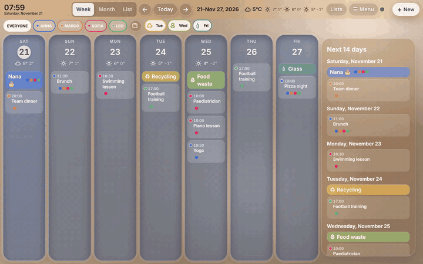
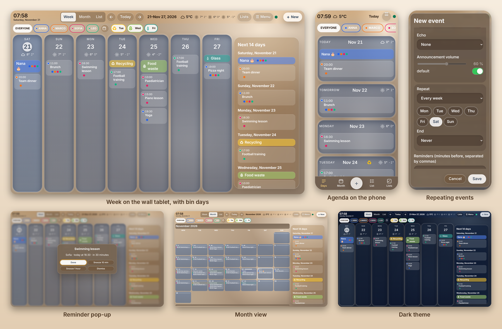

<p align="center">
  
</p>

<h1 align="center">Family Hub</h1>

<p align="center">
  <a href="https://github.com/EdisonACDC/family-hub/releases"></a>
  <a href="https://analytics.home-assistant.io/custom_integrations.json"></a>
  <br>
  <sub>Downloads also include updates; active installations come from Home Assistant Analytics (only people who turned on analytics).</sub>
</p>

<p align="center">
  <b>English</b> · <a href="README.it.md">Italiano</a> · <a href="README.de.md">Deutsch</a>
</p>

<p align="center">
  The family calendar Home Assistant was missing: one colour per person, reminders on phone, Alexa
  and wall tablet, bin days and school holidays – set up in minutes, no YAML.
</p>

<p align="center">
  <a href="https://github.com/EdisonACDC/family-hub/releases/latest"></a>
  <a href="https://hacs.xyz/"></a>
  <a href="https://ko-fi.com/edisonacdc"></a>
</p>

<p align="center">
  <a href="https://my.home-assistant.io/redirect/hacs_repository/?owner=EdisonACDC&repository=family-hub&category=integration"></a>
  &nbsp;
  <a href="https://my.home-assistant.io/redirect/supervisor_add_addon_repository/?repository_url=https%3A%2F%2Fgithub.com%2FEdisonACDC%2Ffamily-hub"></a>
</p>

<p align="center">
  
</p>

<p align="center">
  
</p>

## Features

- **Week view** on the wall tablet and the PC, and an **agenda** on the phone (today and tomorrow).
- **One colour per person**, all-day and timed events, filters per calendar, and a **+** button for new events.
- **Repeating events**: every day, weekly on the days you choose, every 2 weeks, monthly, yearly. They
  end never, on a date, or after a number of times. Editing or deleting asks: *only this*, *this and
  the following*, or *all*.
- **Reminders**: pop-ups on the tablet (*Done*, *Snooze*, *Stop*), phone notifications with buttons,
  Alexa or text-to-speech, and morning and evening summaries.
- **Bin days**: one reminder per pickup, the evening before and in the morning. Types are recognised
  from the event title (Restmüll, Bio, Papier, Gelber Sack, Glas), colours can be changed. Pickups can
  also be made by hand: weekly, every 2 or 4 weeks, or monthly, with extra and skipped dates.
- **Weather** from the entity you choose: at the top, under each day, and in the summaries.
- **Shifts** per person, entered across several days.
- **Shopping lists** from Home Assistant's to-do lists.
- **Roles**: adults see everything, children see their own events and reminders, guests can only read.
- **External calendars** (ICS): school holidays, public holidays, bins from your municipality. Read-only.

## Installation

1. **Install the integration.** In HACS, open **⋮ → Custom repositories**, add
   `https://github.com/EdisonACDC/family-hub` as an **Integration**, install **Family Hub**, then restart
   Home Assistant. Add it under **Settings → Devices & services → Add integration**.
2. **Install the add-on.** Use the button above, or go to **Settings → Add-ons → Add-on Store → ⋮ →
   Repositories** and paste `https://github.com/EdisonACDC/family-hub`. Open **Family Hub UI**, press
   **Install**, then **Start**.
3. **Open Family Hub** from the side menu. The setup guide opens by itself the first time: name the
   family, add the people, choose the calendars, and you are done.

The add-on needs the integration to be set up first.

> **Mind the name in the Marketplace.** Searching for “Family Hub” also shows **Family Hub Card**, by another author: it is not this project. Choose **Family Hub** of type **Integration**, by **EdisonACDC**.

## Configuration

Everything is set from the guide, or later from **Settings → Devices & services → Family Hub → Configure**:

- **Family**: name, language, first day of the week, 24 h or 12 h clock.
- **People**: name, colour, role (adult, child, guest), linked Home Assistant user, phone and speaker for
  alerts, quiet hours.
- **Calendars**: categories such as Family, School, Doctor, Birthdays, or your own.
- **Reminders**: how early, which channels, family quiet time, summary times.
- **Sources**: to-do lists, calendars already in Home Assistant, one weather entity (`weather.*`).
- **External calendars** (adults only): an ICS file from a link or a file. Refreshed every 12 hours.
- **Alerts**: per person, the phone and Echo speaker chosen from those Home Assistant knows, channels,
  announcement volume, quiet time, and a test.

## Invites for the grandparents

From Family Hub 0.9, people **without a Home Assistant account** (the grandparents, for example) can have Family Hub on their phone as an app, see only the appointments you choose, add their own and get notifications.

1. As an adult, open **☰ → Sharing → Invites** and create an invite: a name (“Grandma”), the persons and calendars it shows (for example Sofia: School, Nursery, Doctor), permissions (“View only”, “View and add”, “View, add and change their own”), where added appointments go (“Need approval”, the default, or “Straight into the calendar”), notifications on or off, and when an unused invite expires (7 days).
2. Send the link with **Copy**, **Share** or let them scan the **QR code**. The link is shown only then and is **personal and single-use**: it works for one phone.
3. The phone opens the link: Android/Chrome offers **Install app**; on iPhone (iOS 16.4+) with **Safari** or **Chrome**: **Share** (in Safari in the bottom bar, in Chrome in the address bar) **→ Add to Home Screen**; the invite is used by opening the icon on the Home Screen (the browser never uses it). If the icon opens on “An invite is needed”, tap **Paste the invite link**.
4. The phone **waits** until an adult confirms it: Home Assistant and the adults' phones get a notification with **Confirm / Reject**, and the phone appears under **Sharing → Devices**.
5. Under **Devices** you can rename a phone, change its permissions or **Turn off** its access, at once. If they change phone, **New phone** makes an invite that replaces the old one, with the same choices. The **Activity log** keeps the last 200 events.

Appointments that need approval show in Family Hub as **“1 appointment to approve”** (Approve / Change / Reject); approved ones are signed “added by Grandma”.

**An external address is needed.** The web app is served by the integration (not by the add-on, because Ingress needs a login) at `/api/family_hub/guest/`. To work away from home, Home Assistant needs an **external URL**: Home Assistant Cloud (Nabu Casa) or your own domain with HTTPS, set under **Settings → System → Network**. Without one the link works only on the home network, and the Sharing page says so.

**Security.** Invite and phone tokens are random (256 bits), kept only as a hash (SHA-256) and never logged; the invite token sits after the `#` of the link, so it never reaches the server's logs. The filter on persons and calendars always runs in Home Assistant: a guest never receives other appointments, other persons, entities or configuration. Requests are limited per phone and per address, an address is blocked after 10 wrong activations, and the phone token is renewed every 30 days. A family that makes no invite has no new reachable address.

**Notifications on the grandparents' phone.** They are turned on with the **🔔 Turn on notifications** button in the app (never by themselves): reminders of the appointments they see (same minutes before and same quiet hours as the family), changes and cancellations, and the outcome of their requests. iPhone needs **iOS 16.4 or later**, with the app opened from its Home Screen icon (added from Safari or Chrome).

**In the web app.** The week and the next days in the family's colours, **+ Add** (when the permission allows it) and, for each phone, its own reminders and quiet hours (empty: the family's). Appointments stay readable without a network (a copy on the phone, wiped when access ends).

**The grandparents' shifts.** When the invite is for a person with **“Has their own work shifts”**, the web app shows **My shifts**: a month board like Family Hub's (choose the shift, tap the days, **Save**) and a rotation to repeat. In the family calendar the shifts read “Grandma · Morning”.

**Privacy.** A guest sees only the persons chosen in their invite; other people's appointments never reach them, not in the app, not in notifications, not in the copy on the phone. An appointment marked **Private** never goes to guests, even when it involves a person they see.

## FAQ

**Do I need Alexa?** No. Speakers are optional; without them the other channels still work.

**Do I need the Home Assistant mobile app?** No. Phone notifications need it; without it those options
are simply hidden.

**Do I need YAML?** No. Everything is set up in the interface.

**Do I need the add-on?** The calendars and reminders work with the integration alone. The wall-tablet
screen is the add-on.

**Where is my data kept?** There is no database. The settings are in the integration's options, and the
content of external calendars is in Home Assistant's storage.

**Does it work in other languages?** Italian, German and English, from the Home Assistant language.

## Status and limits

- Tested with Home Assistant 2026.10.4 on a test installation (automated tests) and on a tablet in the
  browser. Still to check on a real home: downloading an external calendar from a link, the notification
  buttons on the phone (the Companion app's `mobile_app_notification_action` event), and Alexa announcements.
- The weather and bin icons were drawn for this project.
- The people and calendars in the tests are invented.

## Support

If Family Hub helps your family, you can buy me a coffee ☕ [ko-fi.com/edisonacdc](https://ko-fi.com/edisonacdc)

If it helps your family, please ⭐ the repo – it helps other families find it.

## Development

Integration (from the main folder, with a test Home Assistant):

```bash
python -m venv .venv
. .venv/bin/activate
pip install -r requirements_test.txt
pytest
ruff check . && ruff format --check .
mypy
```

Add-on (with a fake Home Assistant and the Microsoft Edge browser):

```bash
cd addon
pip install -r requirements.txt pytest playwright
pytest
```

## License

MIT, see [LICENSE](LICENSE). Add-on changelog: [addon/CHANGELOG.md](addon/CHANGELOG.md).
